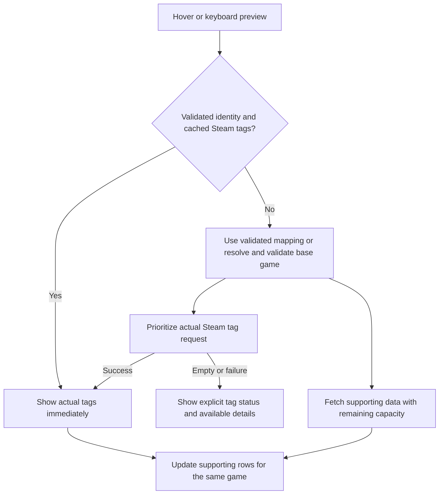

# Historical audit: 3 November 2026

Historical audit/proposals: the user rejected the proposed review restyling and hyperlinks. Current behavior restores the original presentation; see [regression fixes](Regressions-2026-11-04.md) and [verification](Verification-and-AI-Workflow.md).

This is the pre-upgrade review, not current runtime documentation. See [delivered upgrades](Shared-Upgrade-Plan.md).

# Shared review and upgrade plan

Reviewed 3 November 2026. This page covers both [1337x Steam Hover Preview](https://github.com/DeonHolo/1337xSteamHoverPreview) and [CS.RIN.RU Steam Hover Preview](https://github.com/DeonHolo/csrinruSteamHoverPreview). It is mirrored in both repositories so either wiki is complete on its own. All upgrades below are proposals; this documentation change does not implement them.

Read [Architecture and site review](Architecture-and-Site-Review.md) for this script's differences, and [Verification and AI workflow](Verification-and-AI-Workflow.md) for evidence, regression cases, and development guidance.

## What should change first

Loading is substantially improvable. Both scripts perform avoidable requests, delay the whole card for reviews, and defer real Steam tags until after an entire page's core preload. Their existing in-flight deduplication and persistent cache are useful foundations.

The user's primary browsing information is actual Steam tags. Optimize time until those tags are visible and include them in the first meaningful card render when the provider succeeds. A description-first card with tags arriving later does not meet that priority. Genres have no role in the proposed default preview.

| Order | Upgrade | User benefit | Effort | Scope |
| --- | --- | --- | --- | --- |
| 1 | Replace the retired reviews route and its parser | Reviews appear again, including for new releases; avoids downloading HTML as JSON | Small | Both |
| 2 | Make actual Steam tags part of the first meaningful card; warm them before distant rows | The information the user reads first is ready on first hover | Medium | Both |
| 3 | Remove the failing multi-AppID full-details request; validate candidates progressively | Fewer requests and much less sequential waiting | Medium | Both |
| 4 | Follow verified DLC parent IDs; enforce match confidence | Correct base-game page, fewer unrelated results | Medium | Both |
| 5 | Repair title parsing and add correction overrides | Less time fighting wrong or missing matches | Medium | Shared resolver plus site cleaners |
| 6 | Prioritize hover and nearby visible rows in one scheduler | Better responsiveness without warming every row | Medium | Both |
| 7 | Split cache freshness by field and key app data by AppID | Fresh release-week reviews, reusable data, fewer sticky failures | Medium | Both |
| 8 | Replace action emoji with small, consistent icons | Cleaner Steam/magnet/latest-page actions | Small | Shared icons plus site actions |
| 9 | Improve keyboard access, error recovery, and viewport handling | Cards remain usable with keyboards, zoom, slow networks, and long titles | Medium | Both |
| 10 | Extract a shared core with fixtures and repeatable builds | Each subsequent fix reaches both products reliably | Medium/Large | Development |

Effort is a relative estimate, not a delivery commitment. Fix urgent endpoint/correctness problems in both scripts before undertaking a broad extraction. Reuse the same regression fixtures during the extraction.

## 1. Reviews: a confirmed endpoint failure

Both scripts request:

```text
https://store.steampowered.com/appreviews/<appid>?json=1&language=all&purchase_type=all&filter=summary
```

The live Portal 2 probe followed a redirect to the Steam homepage and received HTTP 200 with 994,444 bytes of HTML. The JSON parser therefore fails. The code catches that error, stores `reviewInfo: null` in an otherwise successful 24-hour record, and hides the review row. Previously cached ratings can make this seem specific to newly released games.

Valve announced retirement of that route for 22 October. Use the replacement `IUserReviewsService/GetAppReviews/v1/` endpoint. [Valve announcement](https://steamcommunity.com/groups/steamworks/announcements/detail/676258795703241581).

### Migration contract

The current documentation permits anonymous requests, uses `input_json` with numeric enums, and removes the old `success` flag. Request the first page with all review types to obtain score totals. Handle HTTP 429 with backoff. [Official review API](https://partner.steamgames.com/doc/webapi/IUserReviewsService).

This request was verified without a key:

```js
const input = {
    appid: 4834840,
    filter: 0,
    languages: ['all'],
    review_type: 0,
    purchase_type: 1,
    num_per_page: 1,
    cursor: '*',
    day_range: 0
};
const url = 'https://api.steampowered.com/IUserReviewsService/GetAppReviews/v1/'
    + '?input_json=' + encodeURIComponent(JSON.stringify(input));
```

The observed envelope is `body.response.query_summary`. Add `@connect api.steampowered.com`. Validate HTTP status and numeric fields; the current `getReviewInfo()` requires `success` and reads the wrong level for this response. Changing only the URL will still leave reviews blank. Keep Steam-store cookie handling out of the new Web API provider.

The example preserves the current all-purchase policy. A storefront-comparison mode can use `purchase_type: 0` for Steam purchases. Include the selected purchase/language policy in cache keys and accessible detail text. Do not promise identical totals across different filters.

The Ecstatica probe returned `Positive`, 44 positive, 0 negative, 44 total. It is a useful release-week regression fixture. Counts are a dated observation, not a permanently correct assertion against the live service.

### Review presentation

Use explicit states: `Loading reviews…`, a successful summary, `No user reviews yet`, and `Reviews unavailable · Retry`. A network or parse failure must never become zero reviews. A small number of reviews should still show the returned count even if no rating category is available.

Prefer `100% positive · 44 reviews` and the supplied Steam category to a five-star conversion. Steam recommendations are thumbs-up/down; the current stars are the script's interpretation. Link the summary to the game's reviews. Make recent reviews an optional later feature after all-time reviews are reliable.

Acceptance: a missing or failed reviews response never blocks title, description, release information, media, or actions. A successful retry updates only the review row.

## 2. Real tags on the first card

The current sequence is:

1. Resolve and fetch core data for every uncached eligible title on the page.
2. Start a second pass to scrape real store tags.
3. On hover, render genres immediately and call `warmSteamTags()`.
4. Save real tags to cache; the already-open card keeps its old markup.

This explains the genre-first experience and why another hover is needed. Cached entries are excluded from `getPreloadNames()`, so a fresh cached card containing only genres also misses the page's tag-warming list.

The requested product direction is actual Steam tags in the first meaningful card. Preload each visible or nearby game's actual tags as soon as its base AppID is validated, then continue to more distant rows. Start that game's tag fetch before spending capacity on distant descriptions, media metadata, or review summaries. Remove the separate whole-page-core-then-tags scheduling barrier.

On hover, render usable cached tags immediately. If tags are genuinely cold, show a compact loading state until actual tags arrive; the first meaningful card includes those tags. Supporting information can fill around them, and reviews must not hold them back. Do not wait for image downloads to finish before showing tags. Retain the current layout until its placement is deliberately changed; this is first a data-priority requirement.

Use `idle / loading / ready / empty / error` tag state. Bound the cold-tag wait through timeout/error handling. A store page with no usable tags should show `Steam tags unavailable` with a restrained retry option, alongside available game information. A failure does not justify showing genres or leaving the user in an indefinite spinner. Keep the current hover generation guard so a late response for game A cannot alter game B. Patch only metadata rows for subsequent refreshes so trailer playback, media selection, and keyboard focus survive.

The tradeoff is explicit: a truly cold first meaningful card includes a Steam HTML request on its critical path. Preparing real tags for nearby rows and caching them reduces how often the user pays that wait. It shifts some store-page traffic earlier in the browsing session; keep it bounded and deduplicated. Actual cold tag latency must be measured, rather than counting an early description-only render as success.

Steam-store tags are community/publisher tags hosted by Steam; they are distinct from the broad `genres` list returned by app details. [Steam tag documentation](https://partner.steamgames.com/doc/store/tags).

The current HTML parser finds `a.app_tag`; it worked for Ecstatica and returned the same five tags visible in the supplied screenshot. Keep HTML parsing in one provider with fixtures. Request an explicit store language, recognize redirects/age checks/unavailable pages, and cache success separately from errors. No documented keyless ranked-tag-name endpoint was established in this review. Treat alternate Steam StoreBrowse interfaces as a separately validated experiment rather than an assumed drop-in API.

## 3. Faster data loading

### Remove the failed batch request

`fetchAppDetailsForIds()` asks for full details for up to five comma-separated AppIDs. The checked `appids=620,570&cc=us&l=en` request returned HTTP 400 and `null`. The fallback then requests every candidate individually, sequentially. This is avoidable latency before rendering begins. The finding applies to the exact full-details request used here; it does not establish that every filtered Steam endpoint rejects batching.

Rank search names cheaply first. Validate a strong exact candidate using one AppID request. Inspect more candidates only when the first is ambiguous, invalid, or a DLC needing parent resolution. Use bounded concurrency for genuinely ambiguous candidates. Cache details and in-flight details by AppID so aliases and repeated listings reuse the same work. Validate each expected result even when HTTP status is 200.

### Shorten the critical path

For five candidates, the current path can make eight metadata requests before the card is ready: one search, one failed batch, five single details, and one reviews request. A later tag scrape makes nine. Image requests are additional. Fallback queries can repeat much of this work.

For a confident exact match with completely cold data, the proposed tags-ready path needs one search, one single-AppID detail response for validation, and one store-page request for tags. Reviews run independently after identity is known, with tag work taking scheduling priority. A validated cached mapping can remove search and allow tag loading immediately; fresh cached tags remove the tag request from the hover path. These are request-count comparisons, not measured end-to-end speedup claims. The earlier two-request core-only path is not a tags-ready card and is not the primary success metric.



### Prioritize user intent

The present promise gate spaces request starts by 50 ms inside one script instance. It does not cap active requests, prioritize hover, coordinate tabs, or respond to rate limits. Pausing the next preload batch also leaves existing requests and queued work running.

Introduce one scheduler per script, with priorities: active hover, nearby visible rows, optional offscreen warming. Promote an already-running prefetch when it becomes a hover rather than duplicating it. Use a configurable conservative concurrency limit, explicit timeout, per-host cooldown, jittered retries for transient failures, and `Retry-After` handling. Retain the GM request handle for cancellation when no consumers remain. Clearing a reference or an in-flight map does not abort a GM request.

Use `IntersectionObserver` to enqueue a small area around visible rows and update priorities as the user scrolls. The current viewport ordering is calculated once. Replace whole-page batches with a worker pool so one slow lookup does not hold every subsequent row in that batch. Warming actual tags for the next likely hovers should happen before distant rows' full metadata. Promote an active hover's tag request above unrelated background reviews/details. Full-page warming can continue after the nearby rows have real tags ready.

Default to less work while hidden. Offer preload choices such as `Nearby rows`, `On hover`, and `Entire page`, plus a clear-cache action in the userscript menu. A 100-150 ms hover-intent delay is worth measuring for incidental pointer sweeps; fresh cache hits should render immediately.

### Bootstrap and rendering details

Both scripts run at `document-idle` but attach preloading only to a future `window.load`. If injected after that event, automatic preloading never starts. Use a single idempotent initializer that checks `document.readyState`, then schedules idle work.

The loading UI measures a hidden tooltip before setting `display: block`. Position after making the shell measurable, then re-clamp when content or images change. Apply `max-inline-size` and `max-block-size` relative to the viewport with internal scrolling. Batch pointer positioning through `requestAnimationFrame` to avoid layout reads on every pointer event.

The active image and all thumbnails currently use `loading="lazy"`. Eagerly load the active header, decode asynchronously, and lazy-load offscreen thumbnails. Use thumbnail-sized screenshots in the small card and full images in theatre where possible. Preload only the adjacent image after interaction. Videos should retain explicit click-to-load behavior. Measure a reasonable direct-video quality default instead of always selecting the largest file.

## 4. Correct base-game and title matching

### Resolve DLC relationships explicitly

Both scripts penalize DLC-like names and prefer `type: 'game'`, but neither follows `fullgame.appid`. If no main game is among the five search results, a DLC can still be selected. If details initially fail, type checking happens before the later details response and is not repeated afterward. The emergency switch to the first game candidate can also select an unrelated game.

The live details response for `2778580` identifies `ELDEN RING Shadow of the Erdtree` as `dlc`, with `fullgame.appid: '1245620'` and `fullgame.name: 'ELDEN RING'`. [Steam-hosted details response](https://store.steampowered.com/api/appdetails?appids=2778580&cc=us&l=en).

Proposed resolution steps:

1. Try a saved user correction or an explicit source-linked Steam AppID, then validate it.
2. Search using the preserved game identity and rank plausible candidates.
3. Fetch details for the best candidate; do not accept an unvalidated app type.
4. For a DLC, follow `fullgame.appid`, fetch its details, and validate the parent. Bound depth and track visited IDs.
5. Resolve store URL, description, media, tags, and reviews to the same final base AppID. Keep the matched DLC ID separately for explanation.
6. If the parent is unavailable or evidence is weak, show candidate choices or Steam search. Do not silently call a DLC or unrelated result the main game.

A soundtrack, demo, upgrade, or package does not necessarily share the same parent-field shape. Use verified relationship data where available; otherwise require selection or a clear fallback. A bundle/package ID must not be treated as an app ID just because it is numeric.

### Add confidence and preserve identity

The score currently starts near 100 for every candidate and has no minimum acceptance threshold. A synthetic unrelated `type: 'game'` scored 139 while an exact DLC scored 50. Both can be accepted, depending on what is present. One-way token overlap also rewards a candidate containing all query words plus unrelated extras.

Use bidirectional token precision/recall, meaningful-token weights, exact normalized matches, and explicit mismatch penalties. Preserve sequel numbers, episode/season identity, remakes, remasters, VR editions, and standalone expansions. Add an acceptance threshold plus a margin between the top two plausible results, calibrated against fixtures. A numeric score is not a calibrated probability.

Compare every fallback result against the original title identity. The current fallback shortens a title up to four times and judges each shortened query independently; dropping a subtitle or sequel token can return the wrong installment. Prefer known metadata removal and curated aliases to arbitrary word deletion. Cache successful aliases back to the original source identity.

Normalize Unicode with decomposition where appropriate and Unicode letter/number matching. Current normalization drops accented and non-Latin letters: a fixture containing `Pokémon 大侠立志传` became `pok mon`. Preserve searchable original text and add transliterated aliases only with evidence.

Keep site-specific cleaning separate. The 1337x cleaner has substring exclusions that reject `Ghost`, `Lost`, and `Demonologist`, and truncates a legitimate title at ` - `. The CS.RIN cleaner rejects `The Beginner’s Guide` because of the word `guide`. The detailed fixes are in the site review.

### Let users correct a match

Add a small `Wrong game?` action with candidate selection and paste-AppID/Steam-URL support. Validate the entered app and resolve its parent under the same policy. Save the correction by site and stable topic/torrent ID plus a title fingerprint. Show `Matched to…` only when there is uncertainty or a parent redirect worth explaining. Provide reset and export/import for corrections.

Existing source pages may contain an explicit Steam link. For CS.RIN, inspect links associated with the topic or an optional first-post lookup; for 1337x, an optional detail-page lookup can help. Bound these requests and scope link extraction to the relevant content. Avoid using unrelated Steam recommendations or signatures as identity evidence. A lazy, reusable source-page fetch is preferable to fetching every thread/torrent during preload.

## 5. Cache behavior and recovery

Current caches are keyed by cleaned search string. Successful records, including missing reviews, persist for 24 hours. Null lookups last 15 minutes in memory and are not persisted. Neither storage nor the request queue is shared between independently installed userscripts.

Split storage into source-to-app mappings, AppID records, tag records, and review summaries. Include region/language and review filters where relevant. Store data freshness separately from enrichment attempts. `updateCachedDataForApp()` currently refreshes the entire record's timestamp even when only recording a failed tag attempt, extending unrelated stale data.

Suggested starting policies to tune with measurements:

| Data | Initial policy | Reason |
| --- | --- | --- |
| Validated mapping | Long-lived, versioned by resolver | Search is unnecessary on every app refresh |
| Description/media metadata | About 24 hours with stale-while-revalidate | Useful stale data is preferable to a spinner |
| Actual Steam tags | Several hours to one day | Independent of fast-changing review counts |
| Release-week reviews | About 15-30 minutes | Early counts change quickly |
| Established-game reviews | A few hours | Reduce traffic while keeping summaries useful |
| Genuine no-match | Short negative cache | Newly listed games can become searchable |
| Network/429/HTML response error | Separate retry/cooldown state | A service failure is not a no-match |

These are proposals, not Steam rate-limit guarantees. Use the service's caching/cooldown behavior as an additional constraint.

Use real LRU eviction, validate stored schema and numeric AppIDs, and bound both record count and approximate size. The present Map order behaves like insertion order, rather than access-based LRU. Store normalized fields actually used by the UI instead of duplicating the entire raw appdetails object and normalized media indefinitely. If retaining raw media is needed for migration, version it explicitly.

Add schema/provider/resolver versions so endpoint and matching fixes invalidate the appropriate records. A cache-clear generation should prevent old in-flight responses from repopulating cleared data. Multiple tabs can overwrite a whole persistent-cache snapshot; later, merge per-record timestamps through userscript storage change notifications. A shared core alone will not merge caches across scripts. Cross-site shared caching would require a combined userscript or a separate service and is unnecessary for the first upgrades.

## 6. Icons and everyday usability

Use a small recognizable Steam mark next to `Open on Steam`, replacing the gamepad emoji in both the card and theatre. Bundle the approved image/SVG asset so an action icon does not add a network request. Use fixed dimensions around 14-16 px, consistent spacing, and an asset variant readable on each theme. Scope CSS so the current broad tooltip `img { width: 100% }` rule cannot turn an inline icon into a full-width image. [Valve branding assets and guidance](https://partner.steamgames.com/doc/marketing/branding).

For 1337x, use a simple monochrome horseshoe magnet icon with `Open magnet` or retain `Magnet Download` if that wording is preferred. The current action opens a URI handler; a generic download arrow suggests a file transfer. Keep the magnet action focused on opening the configured handler. For CS.RIN, use an external-link or last-page icon beside `Open Latest Page`. Keep visible text so meaning does not depend on icons.

Other high-value shared QoL:

- Show summaries with a percentage, real count, and a clear unavailable/zero state; retain readable contrast in native themes and Dark Reader.
- Render upcoming releases as `Coming soon` or `Planned release`, using `release_date.coming_soon`, instead of always `Released`.
- Add keyboard-triggered preview, focus entry/exit, Escape dismissal, and a visible focus indicator. Interactive cards need popover/dialog-like behavior rather than a noninteractive ARIA tooltip.
- Trap/contain focus in theatre, name the dialog with its title, and restore focus to the invoking control on close. Opening already focuses the close button; closing currently does not restore focus.
- Support reduced motion and a stable transition from the title to the action row. An optional explicit pin can help long reading, but should be a product choice rather than an automatic change to hover behavior.
- Keep the loading shell stable, preserve media selection during metadata refresh, show image failure placeholders, and make error retries local to the failing field.
- Add a small userscript-menu settings surface: preload policy, tags behavior, theme, cache clear, and debug export. Avoid turning the compact card into a settings panel.

## 7. Which APIs to use

| Need | Recommendation | Contract/limitation |
| --- | --- | --- |
| User review summary | New official `IUserReviewsService` provider | Proven anonymous response; normalize its envelope and handle HTTP errors |
| Descriptions, media, app type, DLC parent | Existing Steam-hosted single-AppID `appdetails` provider | Observed working; retain fixtures and validation because a hosted storefront route is not the same as a documented stable Web API contract |
| Search | Existing Steam Store search behind a resolver interface | Candidate retrieval, not an authoritative identity match |
| Ranked tag names | Steam store HTML provider initially | Tested working; isolate its selector contract and detect blocked/changed pages |
| Broad application catalog | Optional future indexed catalog job | Official `IStoreService.GetAppList` documents key-based access and app-type filters; it is not a fuzzy title resolver |
| SteamDB data | Keep outbound SteamDB links | No general public API is offered in its FAQ; automated scraping is disallowed |

Sources: [official catalog service](https://partner.steamgames.com/doc/webapi/IStoreService), [SteamDB API/scraping FAQ](https://steamdb.info/faq/#does-steamdb-have-an-api). A private partner arrangement with SteamDB would be a different project; it is not needed for the present reviews or DLC fixes.

Do not embed private keys in distributed userscripts or fetch the entire Steam catalog in every browser session. A future catalog snapshot can be generated during a controlled build job, provided it has a clear freshness strategy for new releases and is worth its maintenance cost. SteamKit/SteamCMD-style catalog collection belongs in a separate service/job if ever needed, not the hover path.

## 8. Centralize development while preserving both products

A lightweight named-function comparison found 87 names present in both scripts and 63 identical declaration bodies. This is evidence of substantial reusable code, not a whole-file similarity percentage. Core networking, title scoring, most media normalization, and much of theatre behavior should have one source of truth.

Recommended arrangement: keep the two public repositories and their independent install identities; designate one repository as the canonical core source. For example, add `src/core` to the CS.RIN repository and distribute a versioned core source package that the 1337x repository pins. Build one standalone userscript per repository. A dependency lock and recorded core revision make propagation explicit and repeatable.

```text
canonical core source
  steam/       providers, parsing, response contracts
  resolve/     identity, confidence, parent resolution, overrides
  cache/       storage abstraction and field freshness
  requests/    priority scheduler, retries, cancellation
  preview/     card, enrichment updates, media, theatre, icons
site adapter in each repo
  selectors, source IDs, raw-title cleanup, theme, actions
build output in each repo
  existing installable userscript filename and metadata
```

Keep these behaviors in adapters:

- 1337x: mirror metadata, torrent eligibility, release suffix parsing, magnet retrieval/actions, native light theme.
- CS.RIN: topic/section recognition, topic IDs, thread tags, latest-page discovery, AppID copy/SteamDB utility, native dark theme and CSP behavior.

Inject GM storage, GM transport, timers, and DOM access at the core boundaries. Share schemas and tests, not mutable page globals. Bundle dependencies at build time so normal use adds no remote code-loading step. If a separate core package becomes unwieldy, a future monorepo generating both release files is an alternative with more repository migration work.

Centralize provider fixes and run both adapter suites for every core revision. Give both releases the same core version while preserving their independent userscript versions, namespaces, storage migration, and install paths. Start with the provider/resolver/scheduler seam, then extract UI sections incrementally. A full UI-framework rewrite has little immediate user benefit here.

## 9. Delivery sequence and definition of success

| Batch | Contents | Done when |
| --- | --- | --- |
| A | Reviews provider/parser, field-level review state, failing-batch removal, verified DLC-parent handling, cleaner false-positive fixes | Recent and established games show reviews; known DLCs resolve to their base; protected titles survive cleanup; both scripts pass the same fixtures |
| B | Tags-first preload/rendering, in-place refreshes, hover-first scheduler, ready-state bootstrap | Actual tags are in the first meaningful card after successful loading; reviews/images do not delay them; tag failures settle explicitly; no stale response crosses games |
| C | AppID-based field caches, overrides, user menu, Steam/magnet/latest icons, keyboard/viewport recovery | Reloads reuse data; corrections survive; clear/retry works; actions remain accessible on both sites |
| D | Shared source package, reproducible builds, fixture suite, release documentation | One core change can be built and checked in both repos without copying runtime logic by hand |

Measure warm/cold time to actual Steam tags as the primary latency metric. Also record the proportion of hovers with tags already cached, first-content/review latency, requests/bytes per unique AppID, and wrong/ambiguous matches in a fixed corpus. Establish a baseline first. A sensible warm-card target is actual cached tags visible within roughly 100 ms after intent, but no network p95 target or speedup factor is established by this review. The first hard requirements are actual tags in the first meaningful successful card, no genre substitution, no review/image blocking of tags, no failing speculative batch request, no wrong-page auto-acceptance, and no duplicate AppID request for aliases in one instance.
